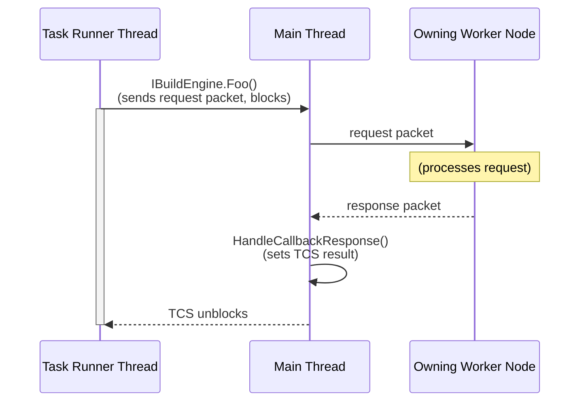
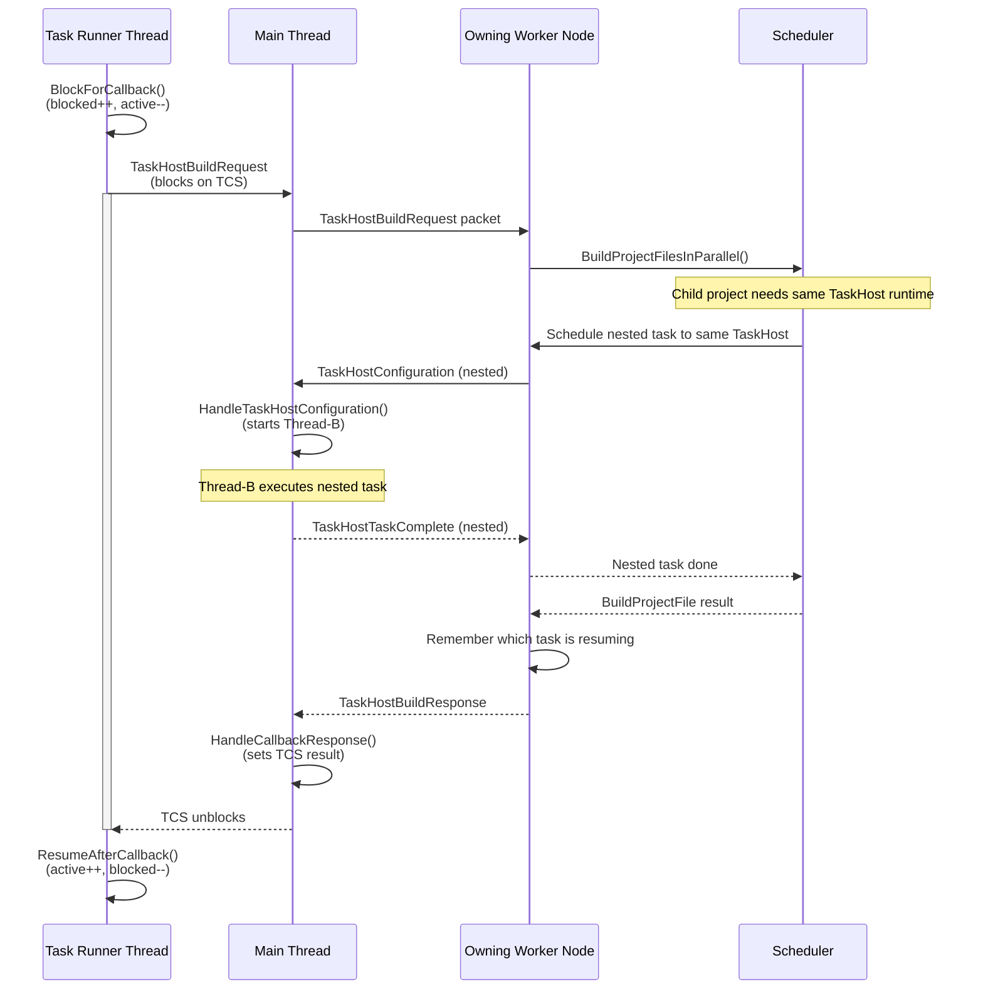
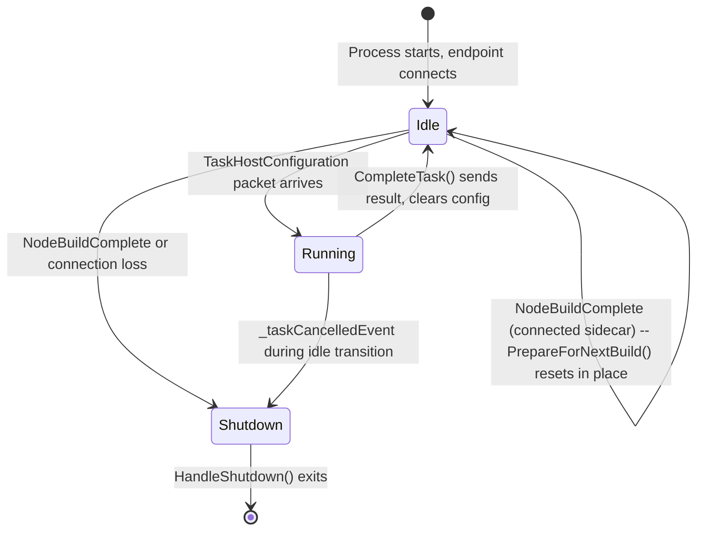

# Threading in TaskHost Processes

MSBuild can run tasks in a separate process called a **TaskHost** (`OutOfProcTaskHostNode`). This happens when a task requires a different runtime, architecture, or when multithreaded mode (`-mt`) ejects a non-thread-safe task out of the worker node. The TaskHost process communicates with the owning worker node over a named pipe.

## Thread Model

The TaskHost has two threads:

### Main Thread (Communication Thread)

The main thread runs `OutOfProcTaskHostNode.Run()`, a `WaitHandle.WaitAny` loop that services four events:

| Index | Event | Handler |
|-------|-------|---------|
| 0 | `_shutdownEvent` | `HandleShutdown()` -- joins the task thread, cleans up, exits |
| 1 | `_packetReceivedEvent` | `HandlePacket()` -- dispatches incoming IPC packets |
| 2 | `_taskCompleteEvent` | `CompleteTask()` -- sends `TaskHostTaskComplete` to owning worker node |
| 3 | `_taskCancelledEvent` | `CancelTask()` -- calls `ICancelableTask.Cancel()` on the task |

This thread is responsible for all IPC: receiving packets from the owning worker node (task configuration, cancellation, callback responses) and sending packets back (log messages, task completion, callback requests).

### Task Runner Thread

When the main thread receives a `TaskHostConfiguration` packet, it spawns the task runner thread (`RunTask`). This thread:

1. Sets up the environment (working directory, env vars, culture)
2. Loads the task assembly and instantiates the task
3. Assigns `TaskEnvironment.Fallback` to tasks implementing `IMultiThreadableTask`, then sets task parameters via reflection
4. Calls `task.Execute()` -- the supplied `TaskEnvironment` (backed by `MultiProcessTaskEnvironmentDriver`) provides access to the task host process's working directory and environment variables
5. Collects output parameters
6. Packages the result into `TaskHostTaskComplete` and signals `_taskCompleteEvent`

The task runner thread is where user task code runs. Any `IBuildEngine` calls from the task (logging, property queries, building other projects) are serviced on this thread.

## IBuildEngine Callback Flow (added in Stage 1)

Before callback support, the two threads had a simple lifecycle: the main thread spawned the task thread, waited for completion, and sent the result. Communication was one-directional (worker node -> TaskHost for configuration/cancellation, TaskHost -> worker node for logs/completion).

With callback support, the task can query the owning worker node for information it doesn't have locally (e.g., `IsRunningMultipleNodes`, `RequestCores`, `BuildProjectFile`). This introduces **bidirectional IPC** between the threads:



### How It Works

1. **Task thread** calls an `IBuildEngine` method (e.g., `IsRunningMultipleNodes`).
2. This calls `SendCallbackRequestAndWaitForResponse<T>()`, which:
   - Assigns a unique request ID
   - Registers a `TaskCompletionSource` in `_pendingCallbackRequests`
   - Sends the request packet via `_nodeEndpoint.SendData()`
   - Blocks on `tcs.Task.GetAwaiter().GetResult()` until the TCS is completed
3. **Main thread** receives the response packet from the owning worker node, looks up the TCS by request ID, and calls `TrySetResult()`.
4. **Task thread** wakes up, retrieves the typed response, and returns it to the caller.

### Cancellation Semantics

The callback wait intentionally does **not** check `_taskCancelledEvent`. This aligns with how in-process `TaskHost` (regular worker node mode) handles callbacks:

- In regular mode, `IBuildEngine` callbacks are direct method calls that always complete. Cancellation never interrupts a callback mid-flight. Instead, cancellation causes the *work behind* the callback to fail fast (e.g., the scheduler cancels a child build started by `BuildProjectFile`), and the callback returns normally with a failure result.
- In TaskHost mode, the owning worker node continues processing callback requests even after sending `TaskHostTaskCancelled`. The response is **guaranteed** to arrive because the worker node's packet loop only exits upon receiving `TaskHostTaskComplete`, which cannot be sent until the task finishes, which cannot happen until the callback returns.

Cancellation is handled cooperatively: after the callback returns, the task checks its cancellation state (set by `ICancelableTask.Cancel()`) and exits.

> **Future opportunity:** Unlike in-process mode where callbacks are direct method calls that cannot be interrupted, the IPC-based callback mechanism *could* support cancellation-aware callbacks -- for example, by failing the pending `TaskCompletionSource` when `_taskCancelledEvent` is signaled. This would let long-running callbacks like `BuildProjectFile` abort immediately on cancellation rather than waiting for the worker node to process and respond. This is not implemented today for consistency with in-process behavior, but the mechanism is in place if needed.

The only exception path is connection loss (owning worker node killed), detected by `OnLinkStatusChanged` which fails all pending `TaskCompletionSource` entries with `InvalidOperationException`. This unblocks task threads immediately.

### Response Guarantee (Why the Callback Cannot Deadlock)

There is a causal dependency chain that prevents deadlock:

```
Worker node sends callback response
  -> TaskHost callback returns
    -> task finishes Execute()
      -> TaskHost sends TaskHostTaskComplete
        -> worker node exits packet loop
```

The worker node cannot exit its packet loop without first receiving `TaskHostTaskComplete`. But `TaskHostTaskComplete` cannot be sent until the task finishes. And the task cannot finish while it is blocked waiting for a callback response. Therefore, the worker node **must** process the callback request and send the response before it can ever stop.

## BuildProjectFile Callback Flow (added in Stage 3)

Tasks running in the TaskHost can call `BuildProjectFile` to build other projects. All four overloads normalize to the canonical 6-param form and send a `TaskHostBuildRequest` packet to the owning worker node, which forwards the call to the in-process `IBuildEngine3.BuildProjectFilesInParallel`.

### Block-for-Callback Pattern

When a task calls `BuildProjectFile`, the TaskHost blocks so the scheduler can reuse the process for nested tasks:



### Counter Management

Two counters track the TaskHost's availability:

- `_activeTaskCount`: Number of tasks actively executing. A non-zero count prevents new tasks from being scheduled.
- `_blockedTaskCount`: Number of tasks blocked on a callback. A blocked task does NOT prevent new tasks from being scheduled.

**Transition ordering**: When blocking, increment `_blockedTaskCount` BEFORE decrementing `_activeTaskCount`. When resuming, the reverse. This ensures the sum is never zero during transition.

### Resuming a Task

The parent associates a TaskHost with the task currently running in it, so it knows
which task should receive the TaskHost's messages. Starting another task changes
that association; resuming a paused task must change it back.

Completing a nested build does not immediately resume its waiting task. The task
first waits for the scheduler to give it its owning node back, as with an
in-process task. It can then resume even if a later-started task is still blocked
on another nested build. The parent must restore its association with the task
**before sending the callback response that lets the task continue**. Both sides
then agree which task is running, and its next messages reach the right receiver.

Attachment and terminal notification are synchronized. A terminal failure notifies every attached task and removes its registrations. Each task sends replies and cancellation through its acquired connection, not a reusable lookup key, so a late reply cannot reach a replacement TaskHost.

### Per-Task Isolation (TaskExecutionContext)

Each task gets a `TaskExecutionContext` stored in `_taskContexts` (ConcurrentDictionary) and accessed via `_currentTaskContext` (AsyncLocal). The context holds configuration, saved environment (CWD, env vars, warning settings), pending callback requests, and execution state. `AllowFailureWithoutError` belongs to this context, so a nested task cannot change its caller's value. `EffectiveConfiguration` reads from the per-task context first, falling back to `_currentConfiguration`.

On .NET Framework, callbacks from a task in another AppDomain carry its task ID in the logical call context. The TaskHost uses that ID to find the same per-task state.

## Yield and Reacquire (Task-ID Routing)

When both peers use packet version 9 or later and change wave 18.14 is enabled, the parent sends a `TaskHostTaskIdentity` packet before each `TaskHostConfiguration`. The identity gives the task a parent task ID that is unique in the parent process. Older peers, the CLR2 `MSBuildTaskHost`, and builds with the 18.14 wave disabled do not use this protocol. For them, `Yield` and `Reacquire` are no-ops and routing is unchanged.

### Why nested-callback support is not sufficient

The TaskHost already lets a second task run in the same process while a first task waits in `BuildProjectFile`. That support depends on two conditions: the waiting task's thread is blocked, and the nested task finishes before the waiting task continues (last in, first out). `Yield` breaks both conditions, because a yielded task continues to run. These examples show where the nested-callback design fails without the changes in this section.

| Scenario | Nested-callback behavior | Result without task-ID routing |
| --- | --- | --- |
| Task A (in project P1) yields and starts `CL.exe`. The scheduler starts task B (in project P2) in the same TaskHost. A finishes first. | The provider sends each packet to the handler on the top of the node's handler stack, which is B's. | A's `TaskHostTaskComplete` and its outputs go to B's `TaskHostTask`. B reports A's result, and A's `TaskHostTask` never completes. |
| A, while yielded, logs warnings from its tool output while B runs. | Log packets also go to the top handler. | A's warnings are attributed to P2 in the build log and binlog. |
| Tasks A, B, and C overlap in that start order. B finishes first. | The provider removes B's handler. C's handler stays on the top of the stack. | A's packets go to C. |
| The child receives B's `TaskHostConfiguration` while A runs. | The child asserts that no task is active (`Assumed.Zero(_activeTaskCount, ...)`). Only tasks blocked in a callback are excluded from that count. | A yielded task is active, so the TaskHost fails the assertion. Without a separate yielded state, the node cannot accept the overlapping task at all. |
| B's configuration sets the process environment and current directory to P2's values while A runs. | `BlockForCallback` saves A's environment, and `ResumeAfterCallback` restores it after A's callback returns. A's thread is blocked between those two points, so it never sees P2's values. | A's thread is not blocked. A tool that A starts after B begins inherits P2's environment variables and directory. Relative paths that A resolves through the process current directory resolve against P2. Task-ID routing does not prevent this. It is the reason for the first limitation below: a yielded task must get its environment and directory from its own saved state, not from the process. |
| A calls `Reacquire`. | No equivalent operation. The `BuildProjectFile` response returns when the nested results are ready, not when the scheduler gives the node back. | A response that only confirms receipt would let A continue while B still occupies the node, so A would run more tasks than the scheduler allows. `Reacquire` must wait for `IBuildEngine3.Reacquire` in the parent to return. |
| The parent cancels A's request, but not B's. | `TaskHostTaskCancelled` cancels every task in the TaskHost. | B is cancelled too. A per-task `TaskHostTaskCancel` is necessary. |
| The base branch, with no other changes. | `Yield` and `Reacquire` are no-ops in the TaskHost. | The scheduler never frees the node while a hosted tool runs. In the 104-project native C++ benchmark at `-m:8` (normal mode, Option A prototype), the median clean build time was 113 s with TaskHost yielding disabled and 47 s with it enabled. |

The nested-callback support provides parts that this design reuses: the per-task `TaskExecutionContext` map, callback request IDs that are unique in the process, and reuse of a TaskHost for more than one task. This section adds the parts that make true overlap possible: task-ID envelopes, a yielded state separate from the callback-blocked state, saving and restoring each task's environment around its yielded interval, a `Reacquire` that waits for the scheduler, and per-task cancellation.

### Packet routing

- The child wraps each task-scoped packet (log events, callback requests, completion) in a `TaskHostTaskEnvelope` that holds the parent task ID. The provider unwraps the envelope and sends the inner packet to the handler registered for that ID. Packets without an envelope go to the most recent handler, as before.
- The parent does not wrap responses. The child matches each response to its request through the request ID, which is unique in the process.
- `TaskHostTaskCancel` cancels one task by ID. The legacy `TaskHostTaskCancelled` packet still cancels all tasks.

### Yield flow

1. The task calls `Yield` on its own thread. The child saves the task's environment and current directory, marks the context as yielded, and sends `TaskHostYieldRequest`.
2. The parent calls the real `IBuildEngine3.Yield`. The scheduler can then start another task on the same worker node, and that task can use the same TaskHost process.
3. The yielded task continues to run. Only one non-yielded task runs in a TaskHost at a time. Yielded tasks can run at the same time as it.
4. `Reacquire` sends a request and blocks until the parent's `IBuildEngine3.Reacquire` returns. Only then does the parent send the response, so the task does not continue before the scheduler gives it its node back. The child then restores the task's environment and current directory.

The child enforces the in-process contract: `Yield` twice, `Reacquire` without `Yield`, or `Reacquire` on a different thread throws. If a task completes, throws, or is cancelled while yielded, the parent reacquires on its behalf before it reports the result. If a disconnect occurs while a task is yielded or reacquiring, the parent unblocks the task and removes all of its registrations.

### Limitations

- A yielded task gives up the process environment and current directory, as an in-process task does. While it is yielded, it must not read or change process-wide state, such as environment variables, the current directory, `Console`, or static fields. Tools that it starts must get their environment and working directory explicitly. The TaskHost cannot enforce this rule. Legacy tasks that break it are not safe to overlap.
- `BuildProjectFile` from a yielded task keeps the behavior from before TaskHost yielding, when `Yield` was a no-op: the child reacquires the node for the task, runs the nested build, and then yields again. The task stays yielded and must still call `Reacquire`. (An in-process task that does this fails the build with an internal error, MSB0001, because the scheduler requires the request to be executing.)
- After a per-task cancel, the TaskHost exits only after all of its task contexts finish.
- If the build is cancelled while a hosted task is in `Reacquire`, the task gets the engine's exception as a `GenericBuildTransferredException`. Its `ToString` keeps the original type name, for example `Microsoft.Build.Exceptions.BuildAbortedException`. An in-process task gets the `BuildAbortedException` itself.

## TaskHost Lifecycle

A TaskHost normally runs one task at a time. While that task waits for a nested
build, another task can use the same process. Tasks do not have to resume in the
order in which they started.

A **sidecar** is a TaskHost that matches its launcher's runtime and architecture and is used for routing of non-multithreadable tasks in `-mt` execution and under `MSBUILDFORCEALLTASKSOUTOFPROC`. Under Change Wave 18.12 a sidecar shares the lifetime of its launcher; opting out of the wave makes it disconnect and idle after each build, as every TaskHost did before.

### Completion Handoff

A finished task leaves its result in a queue for the main thread to send. This
keeps a later result from overwriting one that has not been sent yet. Buffered
console output is sent before the result.

### Event Loop Cycle



1. **Idle**: `WaitAny()` blocks on the four wait handles. No task thread exists. `_currentConfiguration` is null.
2. **TaskHostConfiguration arrives**: `HandleTaskHostConfiguration()` stores the config and spawns a task runner thread (stored in `TaskExecutionContext.ExecutingThread`) to call `RunTask()`. The main thread immediately returns to `WaitAny()`.
3. **Task executes**: `RunTask()` sets up the environment, loads the task assembly, calls `task.Execute()`, and collects output parameters. After cleanup, it enqueues its `TaskHostTaskComplete` result and signals `_taskCompleteEvent`.
4. **CompleteTask()**: The main thread wakes on index 2 and sends the queued results, flushing console output before each one. When no tasks remain active or blocked, it clears `_currentConfiguration`.
5. **Back to step 1**: The main thread loops back to `WaitAny()`, ready for another `TaskHostConfiguration` or a `NodeBuildComplete`.

### State Between Tasks

Each new `TaskHostConfiguration` carries a full environment snapshot, task parameters, and warning settings. The task runner thread resets per-task state at the start of `RunTask()`:

**Reset per task:** `_currentConfiguration`, `_debugCommunications`, `_updateEnvironment`, `_warningsAsErrors`/`_warningsNotAsErrors`/`_warningsAsMessages`, `_fileAccessData`, per-task `TaskExecutionContext`

**Persists across tasks (within a single build):**
- `s_mismatchedEnvironmentValues` (static) -- environment variable fixups for bitness differences, computed once per process. Starting with Change Wave 18.13, only the documented Windows WOW64 variables (`PROCESSOR_ARCHITECTURE`, `PROCESSOR_ARCHITEW6432`, `ProgramFiles`, `ProgramW6432`, `CommonProgramFiles`, and `CommonProgramW6432`) are reconciled. Unix task hosts do not apply these Windows-specific fixups. Other variables come from the task's environment, including additions, replacements, and removals that differ from process startup. They also pass back to the parent without reverse fixups, so an earlier task or build cannot overwrite later virtualized state through this table. Opting out of Wave 18.13 restores the legacy behavior of reconciling all startup differences.
- `_registeredTaskObjectCache` -- task object cache with `Build` lifetime scope. A TaskHost whose current `Run()` call ends disposes it in `HandleShutdown()`; the next `Run()` call creates a fresh one. A sidecar stays connected across builds, so it disposes the `Build`-scoped objects in `PrepareForNextBuild()` and keeps the cache instance itself.
- `_pendingCallbackRequests` / `_nextCallbackRequestId` -- callback tracking (should be empty between tasks)

### Shutdown vs. Reuse

When the owning worker node sends `NodeBuildComplete`, `HandleNodeBuildComplete()` decides whether to exit or stay alive:

With Change Wave 18.12 enabled, a parent that negotiates packet version 6 or later sends an explicit `NodeBuildCompleteAction.ReuseWithConnection` to its reusable **sidecar** TaskHosts. They keep their named-pipe connections and reset in place via `PrepareForNextBuild()`. `NodeBuildCompleteAction.Shutdown` terminates the TaskHost, including one that is already idle.

Legacy completion packets retain their original behavior: a TaskHost launched with node reuse disconnects for pooling. A TaskHost launched without node reuse exits unless both `PrepareForReuse` and `Traits.Instance.EscapeHatches.ReuseTaskHostNodes` allow reuse. Explicit `TaskHostFactory` requests are launched without node reuse.

A retained sidecar echoes `NodeBuildComplete` after disposal and reset. Its owner keeps it in the active set until that reply arrives, so `EndBuild()` waits for build-scoped cleanup without disconnecting the sidecar. Connection failure also releases the wait and removes the failed connection.

When node reuse is disabled, current same-runtime, same-architecture TaskHosts are retired locally before shutdown is queued. `EndBuild()` does not wait for their disposal or process exit. The sender drains the shutdown request, and the reader closes when the child replies or exits. A retiring host cannot be acquired by the next build, and its late notifications cannot remove a replacement. Attached tasks still receive the terminal notification if retirement occurs during build abort. Legacy and compatibility hosts keep their existing shutdown waits.

The reset releases the build's working directory while the sidecar is idle, so Windows does not keep that directory open. Each task's configuration sets its working directory and environment again before execution.

Because a sidecar stays connected, its owner exiting -- normally, via `dotnet build-server shutdown`, or by crashing -- breaks the pipe, and the `LinkStatus.Failed` handler terminates it. Reaping a sidecar therefore requires no shutdown cascade and no process enumeration: it is reachable through the connection it already holds. A sidecar has no idle timeout; it waits indefinitely on its owner's connection.

Disposing a `BuildManager` requests shutdown of its connected TaskHosts even when the hosting process continues. A worker node instead keeps its provider across builds and requests TaskHost shutdown when the worker terminates. A retiring TaskHost may remain alive briefly while it disposes its state. Connection closure also stops the parent's packet sender. Active task code must still return before the TaskHost can finish its shutdown.

#### Lifetime change

Before [#14584](https://github.com/dotnet/msbuild/pull/14584), sidecar TaskHosts disconnected at the end of every build and awaited a new connection from any compatible process. They now stay connected to their launchers:

| configuration | before | after |
|---|---|---|
| `-mt` routing of a non-multithreadable task | disconnects and idles after build | **sidecar stays connected to launcher** |
| `MSBUILDFORCEALLTASKSOUTOFPROC` | disconnects and idles after build | **sidecar stays connected to launcher** |

TaskHosts required for a different runtime or architecture are unchanged. Reusable ones continue to disconnect so another compatible process can claim them. CLR2 TaskHosts are never node-reused, and TaskHosts created by an explicit `TaskFactory="TaskHostFactory"` request are deliberately launched without node reuse; both exit at the end of the build. Keeping reusable cross-runtime or cross-architecture TaskHosts connected would cost one idle process per worker node for a task that only ever runs in one of them at a time: with ten projects of which one needs an `Architecture="x86"` TaskHost, under `-m:4` and reordered so the scheduler places it on a different worker each build, staying connected left three idle TaskHosts (~153 MB) where disconnecting leaves one (~51 MB).

A sidecar runs the same runtime and architecture as its launcher, so sharing across processes is less helpful. Packet version 6 adds explicit actions and the cleanup reply to `NodeBuildComplete` without changing its legacy reuse flag. The parent selects ownership only when the child supports this protocol. Older parents can send `PrepareForReuse=true`, so that flag alone never establishes ownership.

A sidecar is therefore never shared across launcher processes. Reuse within one launcher's lifetime -- including consecutive command-line invocations handled by the same MSBuild server or any long-lived `BuildManager` -- is unchanged, which is where it pays off.

Older SDK TaskHosts continue to use legacy pooling. A newer TaskHost connected to an older parent also uses legacy pooling and sends the shutdown acknowledgment that parent expects. The parent's runtime is not an ownership capability: a Framework parent can legitimately launch a newer SDK's .NET TaskHost.
