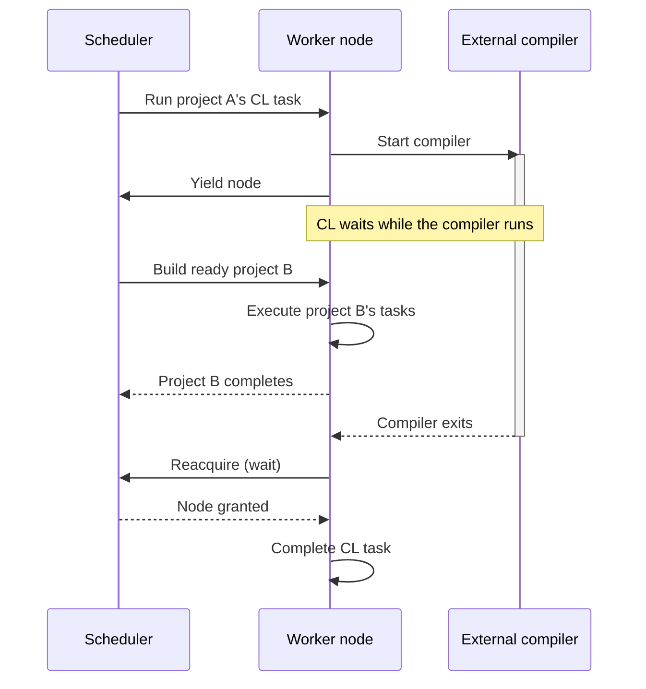
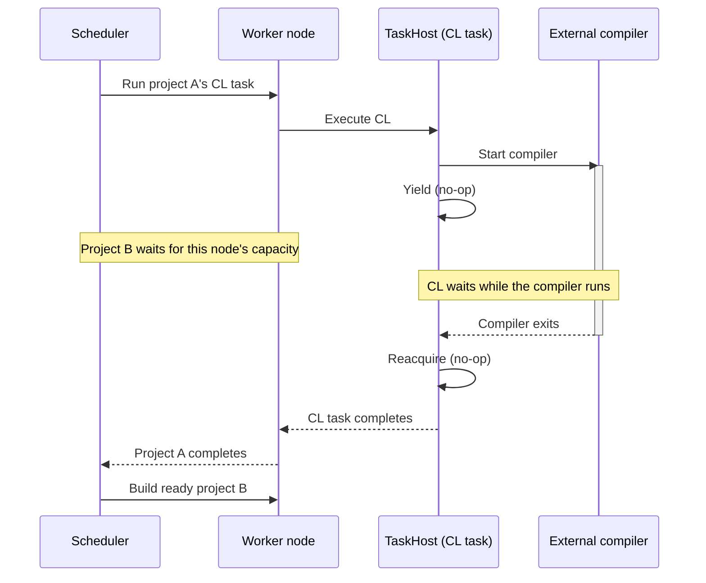
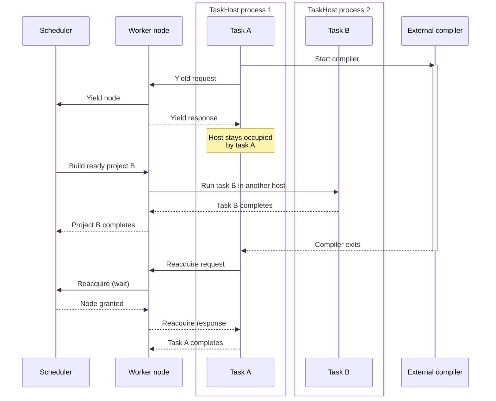
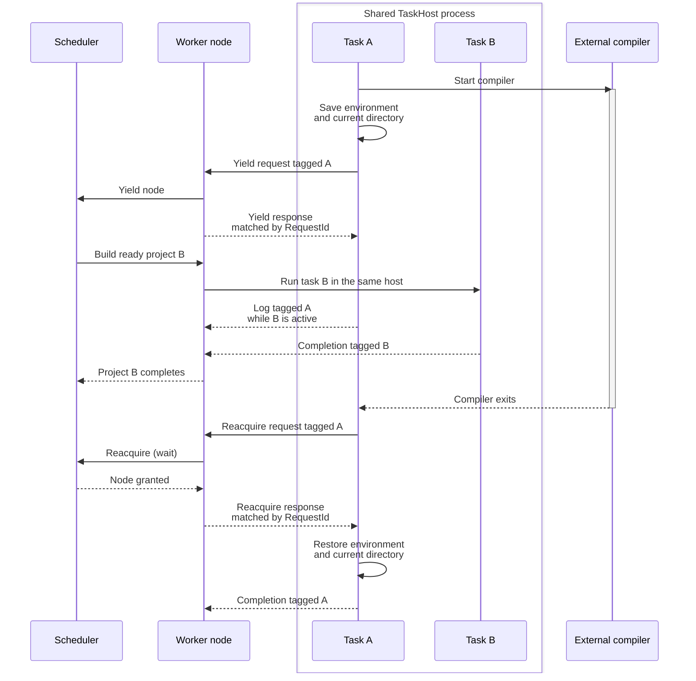

# Yield and Reacquire in TaskHosts

**Status:** Proposed. This document compares two prototype designs and recommends one.

Related documents:

- [Threading in TaskHost Processes](taskhost-threading.md) describes the current TaskHost thread model, callbacks, and lifecycle.
- [Multithreaded MSBuild](multithreaded-msbuild.md) describes `-mt` mode and sidecar TaskHosts.
- [Threading](../threading.md) describes `Yield` and `Reacquire` for in-process tasks.

## Problem

Moving C++ tasks into a TaskHost removes an existing scheduling benefit: other projects cannot use the task's node while its compiler runs.

The components have different roles:

- The **scheduler** assigns projects to worker nodes.
- A **worker node** executes projects. A task runs either inside that node or in a separate **TaskHost** process.
- An **external tool**, such as the compiler, runs in another process. It does not run inside the worker node or TaskHost.

`IBuildEngine3.Yield()` returns the task's node capacity to the scheduler. `Reacquire()` waits until that capacity is available again.
The C++ `CL` and `MIDL` tasks (CPPTasks) enable this behavior by default through `YieldDuringToolExecution`.
The task starts its external tool, yields, and waits for the tool. The compiler continues running while the scheduler uses the node for another project.

### Current in-process behavior

This example shows one worker node and two ready projects. Project A's compiler runs while that node builds project B.

### Current TaskHost behavior

In `OutOfProcTaskHostNode`, `Yield` and `Reacquire` are no-ops. No yield request reaches the scheduler.
The node's scheduling capacity stays reserved while the compiler runs. Other nodes can still work, but another project cannot use this capacity.

This affects tasks hosted for compatibility or isolation:

- CLR4 tasks under `dotnet build`, or tasks that need a different architecture
- non-thread-safe tasks moved into sidecar TaskHosts by multithreaded mode (`-mt`)
- tasks explicitly assigned to `TaskHostFactory`, or forced out of process with `MSBUILDFORCEALLTASKSOUTOFPROC`

The goal is to restore scheduling overlap across the TaskHost boundary, not to move compilers into TaskHosts or change the compiler's work.
Both options forward `Yield` and `Reacquire`. They differ in whether another task can use the same TaskHost while the first task remains yielded.

### Measurements

On a 104-project native C++ workload at `-m:8`, the in-process clean build took about 39 s.
`MSBuild.exe -mt` took about 99 s. The later, contemporaneous yield-disabled comparison took about 103–104 s.
These are not one controlled comparison: the earlier baselines were captured on a different day.
See [Performance](#performance) for both prototypes, sample counts, and provenance.

Earlier baseline measurements, as medians:

| Configuration | Clean | No-op |
|---|---:|---:|
| `MSBuild.exe`, in-process tasks | 39.2 s | 3.3 s |
| `MSBuild.exe -mt` (`CL`/`MIDL` in a TaskHost, `Yield` is a no-op) | 99.4 s | 3.6 s |
| `dotnet build` (CLR4 TaskHost, no yield) | 117.7 s | 11.9 s |
| `dotnet build -mt` (no yield) | 113.0 s | 9.6 s |

The `YieldDuringToolExecution` comparison supports the importance of yielding for clean builds. With it disabled, in-process clean builds took 66.1–95.8 s, compared with 35.5–37.7 s when it was enabled.

## Design decisions

Returning a node does not finish the task. Its thread, compiler, and callbacks can remain alive while another project uses that node.
This creates the decisions below. Both options use the existing scheduler rather than introduce a second scheduling policy.

| Decision | Why it matters | What the options must resolve |
|---|---|---|
| **Yielded-task lifetime** | A yielded task can log, finish, fail, or be cancelled before it reacquires. Releasing node capacity must not discard its context. | A keeps its host occupied. B keeps a separate context for each task in a shared host. Both track yield state through cleanup. |
| **Process-wide state** | Environment variables, the current directory, `Console`, and static fields belong to the process, not to a task context. | A uses separate processes. B saves and restores selected state, but requires an unenforceable rule against process-wide access while yielded. |
| **Routing and cancellation** | Task A can send a packet while task B is active. Cancelling A must not accidentally cancel B. | A separates overlapping tasks by host. B identifies task-scoped packets and cancellation by task ID. |
| **Nodes and cores** | Yielding changes scheduler ownership, not the compiler's OS execution. External compilers can overlap even with a fixed node budget. | Both use existing node and core accounting. A task resumes non-yielded work only after scheduler reacquisition. See [shared requirements](#requirements-common-to-both-options). |
| **Build time and memory** | Separate hosts consume memory, while shared hosts require more complex routing and accept interference risk. | Compare elapsed build time, host count, and peak RSS. CPU utilization was not measured, so the data does not establish CPU efficiency. |

The central choice is therefore **process isolation (A)** versus **shared-host reuse (B)**.
The [recommendation](#recommendation) weighs the measured benefit against the isolation risk.

## Option A: process-level isolation

Prototype: [branch `baronfel-taskhost-yielding`](https://github.com/dotnet/msbuild/tree/baronfel-taskhost-yielding), current [commit `9f3b3ae8b9`](https://github.com/dotnet/msbuild/commit/9f3b3ae8b9dcda9c8f4fb990f06780241772ad20).

Each overlapping task uses a separate TaskHost process. A yielded task keeps its host slot (`TaskHostNodeKey.HostSlot`) occupied until it finishes.

### How Option A restores overlap

The scheduler reuses the node, but not task A's occupied TaskHost. Task B uses another new or idle host of the same kind.
The external compiler and task B overlap without sharing TaskHost process state.

### Protocol

- `TaskHostYieldRequest` and `TaskHostYieldResponse`.
- `TaskHostYieldConfiguration`, which carries the parent's change-wave policy before each task configuration.
- There are no other changes to routing. The provider keeps its existing handler stacks.

### Behavior

- Each running task has its own TaskHost process. The environment, current directory, `Console`, and static fields are isolated from other tasks. External resources, such as files, can still be shared.
- A yield-capable host runs the nested tasks of a `BuildProjectFile` callback in a separate process. Otherwise the outer task could resume in the same process while an inner task is still yielded. This removes the existing reuse of the process for nested tasks.

## Option B: shared TaskHosts with task-ID routing

Prototype: [branch `baronfel-taskhost-yielding-option-b`](https://github.com/dotnet/msbuild/tree/baronfel-taskhost-yielding-option-b), current [tip `b841c2dbe9`](https://github.com/dotnet/msbuild/commit/b841c2dbe9fb2f5ab7a4a4d610e74696bb4e23d2).
Tested implementation: [commit `09842896bd`](https://github.com/dotnet/msbuild/commit/09842896bd1e4255ef57b02b6bd6fc52565e1436).

There is one TaskHost per (worker node, runtime) key, as today. Each host runs at most one non-yielded task, plus any number of yielded tasks.

### How Option B restores overlap

The scheduler reuses the node and the same TaskHost. Task A remains yielded while task B uses that process.
Task IDs keep their messages separate. They do not isolate process-wide state.

### Protocol

- `TaskHostTaskIdentity` gives the next `TaskHostConfiguration` a task ID that is unique in the parent process.
- `TaskHostTaskEnvelope` wraps each task-scoped packet from the child (log events, callback requests, completion) with its task ID. The provider sends the inner packet to the handler for that ID (`_taskIdToHandler`). A packet without an envelope goes to the existing handler stack.
- Responses are not wrapped. The child matches each response to its request by `RequestId`.
- `TaskHostYieldRequest` and `TaskHostYieldResponse`.
- `TaskHostTaskCancel` cancels one task. The legacy `TaskHostTaskCancelled` still cancels all tasks in the host.

### Behavior

- `Yield` saves the task's environment and current directory. `Reacquire` restores them, as the in-process engine does for a yielded project.
- If a yielded task calls `BuildProjectFile`, the child reacquires the node, runs the nested build, and then yields again. This keeps the TaskHost behavior from before this feature. An in-process task that does this fails with MSB0001.
- The TaskHost process must register the exception serialization contract (`OutOfProcTaskHostNode.InitializeSerializationContract`). Without it, a `BuildAbortedException` in a yield response crashes the shared host, and all tasks in that host fail. The prototype includes this fix.

### Risks and limitations

- **Shared process state.** While yielded, a task must not read or change process-wide state: environment variables, the current directory, `Console`, or static fields. A tool started while the task is yielded must get its intended environment and working directory explicitly. The TaskHost cannot enforce this rule. A task that breaks it can affect other tasks in the same host. In-process yielded tasks have the same rule, but explicit TaskHost yields did not previously allow this overlap.
- `Console` redirection is shared by all tasks in the host.
- After a per-task cancel, the host exits only after all of its task contexts finish.
- Log messages that arrive after an abort can be lost.
- If the build is cancelled while a task waits in `Reacquire`, the task gets a `GenericBuildTransferredException`. An in-process task gets `BuildAbortedException`. `ToString()` keeps the original type name.
- The protocol change is larger, and routing changes for all task-scoped packets when the feature is enabled.

### Relation to the existing `BuildProjectFile` callback

The existing nested `BuildProjectFile` callback already supplies much of the foundation for Option B:

- The callback uses the same scheduler path as an in-process task that builds a project reference. The calling task's node is given back while the nested build runs.
- While the calling thread waits, another task can run in the same TaskHost. The TaskHost keeps one `TaskExecutionContext` per task, and saves and restores the environment and current directory around the callback (`BlockForCallback`, `ResumeAfterCallback`).
- When a scheduled nested build completes normally, the callback waits for the scheduler to reacquire the node before the parent sends `TaskHostBuildResponse`.
- If the request is still active and not cancelled, `TaskHostTask` attempts to reactivate its handler before sending the response. `TryReactivateTaskHandler` moves that handler to the top of the provider's handler stack, even if another task is still blocked. Resumption is therefore not strictly last-in, first-out.

The callback model does not cover explicit `Yield`:

- `IBuildEngine3.Yield()` and `Reacquire()` are no-ops in the TaskHost. A callback blocks the calling thread, although other threads created by the task can still run.
- A truly yielded task continues to run while another task is active in the same process. The yielded task can log or complete during that time.
- The provider routes task-scoped packets such as logs and completion to the handler at the top of the stack. A packet from a yielded task can therefore go to the active task's handler.

Option B adds these parts to the callback foundation:

- Task-ID envelopes and `_taskIdToHandler` routing, so that each packet reaches the handler of the task that sent it.
- Per-task cancellation with `TaskHostTaskCancel`.
- Forwarding of `Yield` and `Reacquire` to the existing scheduler path in `TaskHostTask`.
- Tracking of yielded task contexts through `Reacquire`, completion, and failure, with a parent-side reacquire if the task ends while yielded.

This reuses the callback foundation, but does not remove the [shared-state risk](#risks-and-limitations).

## Comparison

### Performance

Measured with `dotnet build -m:8` on the same workload. Times are elapsed wall-clock times. CPU utilization was not measured. Process counts and peak process-tree RSS are for clean builds.

Both published prototype branches are rebased on the CLR4 TaskHost support [commit `102f08a36b`](https://github.com/dotnet/msbuild/commit/102f08a36b153123ffa697a250a68b6f7e26b572).
The measurements used Option A [commit `1499e7d2e3`](https://github.com/dotnet/msbuild/commit/1499e7d2e3415428ee70239a87d0fbbc3e0436f1) and Option B [commit `1bd382fdcc`](https://github.com/dotnet/msbuild/commit/1bd382fdcc707651a8b091e4cf52415c595bcd4f).
The rebased implementation commits (`9f3b3ae8b9` and `09842896bd`, respectively) have identical Git trees to their measured counterparts.
Option B's current tip adds only documentation after its tested implementation commit.

Normal mode, 4 rounds of each option. Runs were sequential, with variant order varied across rounds:

| Configuration | Clean | No-op | TaskHost processes | Peak process-tree RSS |
|---|---:|---:|---:|---:|
| Option A | 41.80 s | 10.15 s | 26–30 | 3.31 GB |
| Option B | 40.17 s | 9.94 s | 8 | 2.37 GB |
| Yield disabled | ~103–104 s | — | 8 | 2.06 GB |

`-mt` mode, 2 rounds of each option. Runs were sequential: A then B in the first round, B then A in the second:

| Configuration | Clean | No-op | TaskHost processes | Peak process-tree RSS |
|---|---:|---:|---:|---:|
| Option A | 40.76 / 40.84 s | 14.93 / 13.61 s | 26 | 2304 MiB |
| Option B | 35.56 / 35.95 s | 8.12 / 7.95 s | 8 | 1345 MiB |

Notes:

- Both options remove most of the clean-build regression. The `-mt` clean build goes from about 113 s to 36–41 s, which is close to in-process `MSBuild.exe` (39.2 s).
- The baselines in [Measurements](#measurements) were captured on a different day, and the sample counts are small.
- The `-mt` prototype no-op builds took about 8–15 s, compared with 3.3 s for the earlier in-process `MSBuild.exe` baseline. These measurements do not establish the cause or whether yield affects no-op performance.

### Summary

| Axis | Option A: process isolation | Option B: shared hosts, task-ID routing |
|---|---|---|
| **Safety** | Stronger process-state isolation. Each running task has its own TaskHost process, although external resources can still be shared. | Weaker. Yielded tasks share process state, and the rule cannot be enforced. A task that breaks the rule or a host crash can affect other tasks in the host. |
| **Implementation** | Small protocol change (yield request, response, and policy). Adds host-slot management, and nested callbacks no longer reuse the process. | Larger protocol change: identity, envelopes, per-task cancel, and routing by task ID. Needs environment save and restore, and more complex cancel and drain logic. |
| **Elapsed build time** | The clean build took 41.80 s in normal mode and about 40.8 s in `-mt`. The `-mt` no-op runs took 13.61–14.93 s. | The clean build took 40.17 s in normal mode and 35.56–35.95 s in `-mt`. The `-mt` no-op runs took 7.95–8.12 s. |
| **Memory** | Highest. 26–30 TaskHosts, 3.31 GB in normal mode and 2304 MiB in `-mt`. Grows with the number of overlapping yielded tasks. | 8 TaskHosts, as without yield. 2.37 GB in normal mode and 1345 MiB in `-mt`. |

## Recommendation

Use **Option B** if its shared-state risk is acceptable, and require these mitigations:

1. **Shared-state guard tests.** Run representative yielding tasks alongside controlled probe tasks in one TaskHost, including the CPPTasks `CL` and `MIDL` paths where feasible. Sample selected environment, current-directory, and `Console` state at synchronized checkpoints. Check restoration and observable interference against the test expectations. Include an intentional mutation at a checkpoint to verify that the probe detects that case. These tests cover selected values and interleavings, not all tasks, static fields, or transient changes between checkpoints.
2. **Restoration diagnostics.** After `Reacquire`, compare selected restored environment and current-directory values with the saved snapshot. Report mismatches through a low-importance message or an `EventSource` event. A mismatch shows that sampled state differs, but does not identify the source. A match does not rule out transient changes or interference that occurred before restoration. The comparison does not cover `Console` or static fields.
3. **Opt-out.** Keep the change wave 18.14 opt-out so builds can return to the previous behavior if shared-state interference is suspected.
4. **Robust host.** Keep the serialization-contract fix and tests that kill or cancel a host while a task waits in `Reacquire`. These tests cover the corresponding paths that could strand sibling tasks.

Neither the tests nor the diagnostics enforce isolation. They cannot guarantee safety for arbitrary tasks. If that residual risk is unacceptable, choose Option A.

The measurements favor B, but sample counts are small.
`ToolTask` starts its external tool before yielding, then waits, logs, and handles cancellation or timeout.
Derived tasks still need to follow the shared-state rule, as in-process yielded tasks do.

## Requirements common to both options

These requirements apply whichever isolation model is selected. Here, the **parent** is the worker node that owns the hosted task.

- **Negotiation.** Both peers must negotiate packet version 9 (`NodePacketTypeExtensions.TaskHostYieldMinVersion`). Older peers and the CLR2 `MSBuildTaskHost` keep no-op behavior.
- **Opt-out.** Change wave [18.14](../../wiki/ChangeWaves.md#1814) gates the feature. Opting out restores no-op calls and current routing. The parent sends its policy before each task, including in a reused host.
- **Reacquire ordering.** The parent responds to `TaskHostYieldRequest(reacquire: true)` only after the real `IBuildEngine3.Reacquire()` returns. The task cannot resume non-yielded work before the scheduler gives its node back.
- **Scheduler accounting.** The parent calls the real `IBuildEngine3.Yield()` and `Reacquire()`. These preserve existing node and core accounting, including release of requested cores on `Reacquire`. See [resource management](../resource-management.md).
- **Contract enforcement.** As in the in-process engine, these calls throw: `Yield` twice, `Reacquire` without `Yield`, and `Reacquire` on a thread other than the one that yielded.
- **Unbalanced exit.** Before processing a result, the parent must reacquire if the task ended while yielded. This also applies when the task throws. See [Reacquire before completion](#reacquire-before-completion).
- **No hangs.** Cancellation or connection loss during `Reacquire` must unblock the task and release its registrations.

### Reacquire before completion

Reacquisition protects scheduler state, not just successful task results. A failed request also needs the correct state before it reports its result.
The current engine checks this late:

- `BuildRequestEntry.Complete` requires `Active` for successful local completion. `Scheduler.ReportResult` requires `Executing` for any result, including failure.
- `TaskHost.MarkAsInactive` does not check yield state. `TaskBuilder` calls it after the task's batches, not immediately after each `Execute` returns.
- A test with the .NET 11 RC1 SDK at `-m:1` reproduced a hang after an in-process task returned while yielded. Later tasks ran first. A failing task in the same state produced MSB0001: the request was `Yielding`, not `Executing`.

Today's no-op TaskHost yield does not cause this state transition. A hosted task that omits `Reacquire` can therefore still succeed.
Both prototypes preserve that behavior by reacquiring in the parent rather than rejecting the task.

`TaskHostTask.ReacquireIfYielded` handles completion, exceptions, host loss, and cancellation. It runs before the parent applies outputs or environment changes.
The parent tracks yield state per task, including each task ID in Option B. It reports a failed reacquire after host cleanup.
Reacquisition can wait for node capacity, so cancellation must also work during this cleanup wait.

An engine change could centralize some cleanup, but detecting an unbalanced task is not enough. The request still needs a safe scheduler transition.
An automatic reacquire must run before results are applied, on the thread that called `Yield`, and must handle cancellation.
`MarkAsInactive` is too late to assume it is the correct hook.
Neither approach removes task-ID routing, TaskHost communication, or the shared-state risk.

Rejecting unbalanced tasks is a separate compatibility decision. Both prototypes allow an otherwise successful hosted task to remain successful after parent-side reacquisition.
A new error or warning can break existing builds, including `-warnaserror` builds. Diagnostics should be messages or opt-in.

## Validation

Both prototypes test:

- overlapping yielded tasks at low node counts (`-m:2`), in normal and `-mt` modes;
- overlapping CLR4 TaskHosts started from .NET MSBuild;
- invalid or unbalanced sequences at `-m:1`, for example `Yield` twice or `Reacquire` without `Yield`, which must not strand the scheduler;
- `Reacquire` that waits for the parent's response and is unblocked by cancellation or disconnection;
- nested `BuildProjectFile` callbacks, including inherited launch settings for .NET TaskHosts; and
- capability and change-wave gating (packet version 8 against 9, and the 18.14 opt-out), plus host reuse.

Option A also tests that hosts occupied by yielded tasks use separate slots and that idle hosts are reused.

Option B also has end-to-end tests for:

- cancelling the build, or killing the host, while a task waits in `Reacquire`;
- nested `BuildProjectFile` callbacks from yielded tasks with several levels, in `-mt` mode, and from CLR4 TaskHosts; and
- overlapping yielded tasks that share one TaskHost process.

Option B must also add the shared-state guard test from the [recommendation](#recommendation).

## Open questions

- **Is shared-state risk acceptable?** B saves memory and had lower elapsed times, but cannot isolate arbitrary yielded task code. Choose A if that risk is unacceptable.
- **Does B need per-task process isolation?** Some tasks cannot follow the shared-state rule. A separate-host setting could preserve isolation without selecting A for every task.
- **What explains the no-op differences?** The measurements show a gap, not its cause or whether yield affects it. More evidence is needed before choosing a fix.
- **Should the engine enforce balanced completion?** Earlier checking or automatic cleanup could also help in-process tasks. The ordering and compatibility constraints in [Reacquire before completion](#reacquire-before-completion) still apply.
