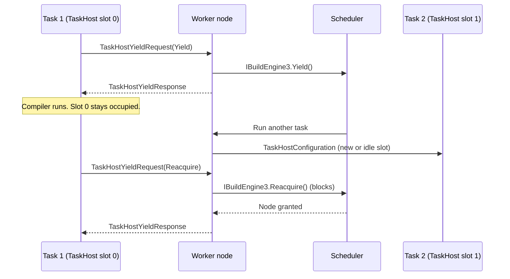
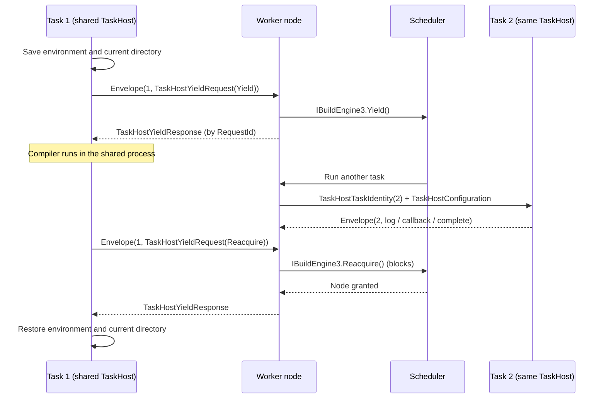

# Yield and Reacquire in TaskHosts

**Status:** Proposed. This document compares two prototype designs and recommends one.

Related documents:

- [Threading in TaskHost Processes](taskhost-threading.md) describes the current TaskHost thread model, callbacks, and lifecycle.
- [Multithreaded MSBuild](multithreaded-msbuild.md) describes `-mt` mode and sidecar TaskHosts.
- [Threading](../threading.md) describes `Yield` and `Reacquire` for in-process tasks.

## Problem

`IBuildEngine3.Yield()` lets a task give its node back to the scheduler while it does work that does not need the node, typically while a long external tool runs. `IBuildEngine3.Reacquire()` waits until the scheduler gives the node back. `ToolTask` does this when `YieldDuringToolExecution` is set. The C++ tasks `CL` and `MIDL` (CPPTasks) set it by default, so other projects can run on the node while the compiler runs.

MSBuild runs a task in an out-of-process TaskHost (`OutOfProcTaskHostNode`) when:

- the task needs a different runtime or architecture (for example, CLR4 tasks such as CPPTasks under `dotnet build`);
- multithreaded mode (`-mt`) moves a non-thread-safe task out of the worker node; or
- `MSBUILDFORCEALLTASKSOUTOFPROC` is set.

In a TaskHost, `Yield` and `Reacquire` are no-ops. The scheduler cannot use the node while the compiler runs, so native C++ builds lose most of their parallelism in `-mt` mode and under `dotnet build`.

### Measurements

A native C++ workload of 104 projects, built with `-m:8`. Values are medians.

| Configuration | Clean | No-op |
|---|---:|---:|
| `MSBuild.exe`, in-process tasks | 39.2 s | 3.3 s |
| `MSBuild.exe -mt` (`CL`/`MIDL` in a TaskHost, `Yield` is a no-op) | 99.4 s | 3.6 s |
| `dotnet build` (CLR4 TaskHost, no yield) | 117.7 s | 11.9 s |
| `dotnet build -mt` (no yield) | 113.0 s | 9.6 s |

`YieldDuringToolExecution` is the cause. With it disabled, in-process clean builds took 66.1–95.8 s, compared with 35.5–37.7 s when it was enabled.

## Requirements common to both options

Both prototypes forward `Yield` and `Reacquire` across the TaskHost boundary with these rules:

- **Negotiation.** The feature is available only when both peers negotiate packet version 9 (`NodePacketTypeExtensions.TaskHostYieldMinVersion`). Older peers and the CLR2 `MSBuildTaskHost` keep the no-op behavior.
- **Opt-out.** The feature is behind [change wave 18.14](../../wiki/ChangeWaves.md#1814). Opting out restores no-op `Yield` and `Reacquire` and the current routing. The parent tells the TaskHost its policy, so a reused TaskHost follows the current parent's wave.
- **Reacquire ordering.** The parent sends the response to `TaskHostYieldRequest(reacquire: true)` only after the real `IBuildEngine3.Reacquire()` returns. The task cannot continue before the scheduler gives its node back.
- **Scheduler accounting.** The parent calls the real `IBuildEngine3.Yield()` and `Reacquire()`. Node and core accounting, including the release of requested cores on `Reacquire` (see [resource management](../resource-management.md)), use the existing scheduler paths.
- **Contract enforcement.** As in the in-process engine, these calls throw: `Yield` twice, `Reacquire` without `Yield`, and `Reacquire` on a thread other than the one that called `Yield`.
- **Unbalanced exit.** If a task completes or throws while yielded, the parent reacquires for the task before it processes the result.
- **No hangs.** Cancellation, or loss of the connection, while a task waits in `Reacquire` must unblock the task and release its registrations.

The main difference between the options is how they isolate the process state of tasks that run at the same time, and how they protect that isolation.

## Option A: process-level isolation

Prototype: branch `baronfel-taskhost-yielding`, commit `1499e7d2e3`.

A TaskHost that contains a yielded, still-running task stays occupied. If other work needs a TaskHost of the same kind, the provider assigns another host slot (`TaskHostNodeKey.HostSlot`), which starts another process. Idle slots are reused.

### Protocol

- `TaskHostYieldRequest` and `TaskHostYieldResponse`.
- `TaskHostYieldConfiguration`, which carries the parent's change-wave policy before each task configuration.
- There are no other changes to routing. The provider keeps its existing handler stacks.

### Behavior

- Each running task has its own process. The environment, current directory, `Console`, and static fields are not shared, so tasks cannot interfere with each other.
- A yield-capable host runs the nested tasks of a `BuildProjectFile` callback in a separate process. Otherwise the outer task could resume in the same process while an inner task is still yielded. This removes the existing reuse of the process for nested tasks.

## Option B: shared TaskHosts with task-ID routing

Prototype: branch `baronfel-taskhost-yielding-option-b`, commit `1bd382fdcc`.

There is one TaskHost per (worker node, runtime) key, as today. Each host runs at most one non-yielded task, plus any number of yielded tasks. Yielded tasks continue to run in the same process as the new task.

### Protocol

- `TaskHostTaskIdentity` gives the next `TaskHostConfiguration` a task ID that is unique in the parent process.
- `TaskHostTaskEnvelope` wraps each task-scoped packet from the child (log events, callback requests, completion) with its task ID. The provider sends the inner packet to the handler for that ID (`_taskIdToHandler`). A packet without an envelope goes to the existing handler stack.
- Responses are not wrapped. The child matches each response to its request by `RequestId`.
- `TaskHostYieldRequest` and `TaskHostYieldResponse`.
- `TaskHostTaskCancel` cancels one task. The legacy `TaskHostTaskCancelled` still cancels all tasks in the host.

### Behavior

- `Yield` saves the task's environment and current directory. `Reacquire` restores them, as the in-process engine does for a yielded project.
- If a yielded task calls `BuildProjectFile`, the child reacquires the node, runs the nested build, and then yields again. This keeps the TaskHost behavior from before this feature. An in-process task that does this fails with MSB0001.
- The TaskHost process must register the exception serialization contract (`OutOfProcTaskHostNode.InitializeSerializationContract`). Without it, a `BuildAbortedException` in a yield response crashes the shared host, and all tasks in that host fail. The prototype includes this fix.

### Risks and limitations

- **Shared process state.** While yielded, a task must not read or change process-wide state: environment variables, the current directory, `Console`, or static fields. Tools that it starts must get their environment and working directory explicitly. The TaskHost cannot enforce this. A task that breaks the rule can now affect other tasks in the same host. In-process yielded tasks have the same rule, but before this feature the TaskHost isolated them from each other.
- `Console` redirection is shared by all tasks in the host.
- After a per-task cancel, the host exits only after all of its task contexts finish.
- Log messages that arrive after an abort can be lost.
- If the build is cancelled while a task waits in `Reacquire`, the task gets a `GenericBuildTransferredException`. An in-process task gets `BuildAbortedException`. `ToString()` keeps the original type name.
- The protocol change is larger, and routing changes for all task-scoped packets when the feature is enabled.

## Comparison

### Performance

Measured with `dotnet build -m:8` on the same workload.

Normal mode, 4 rounds of each option, run at the same time:

| Configuration | Clean | No-op | TaskHost processes | Peak process-tree RSS |
|---|---:|---:|---:|---:|
| Option A | 41.80 s | 10.15 s | 26–30 | 3.31 GB |
| Option B | 40.17 s | 9.94 s | 8 | 2.37 GB |
| Yield disabled | ~103–104 s | — | 8 | 2.06 GB |

`-mt` mode, 2 rounds of each option:

| Configuration | Clean | No-op | TaskHost processes | Peak process-tree RSS |
|---|---:|---:|---:|---:|
| Option A | 40.76 / 40.84 s | 14.93 / 13.61 s | 26 | 2304 MiB |
| Option B | 35.56 / 35.95 s | 8.12 / 7.95 s | 8 | 1345 MiB |

Notes:

- Both options remove most of the clean-build regression. The `-mt` clean build goes from about 113 s to 36–41 s, which is close to in-process `MSBuild.exe` (39.2 s).
- The baselines in [Measurements](#measurements) were captured on a different day, and the sample counts are small.
- The remaining no-op difference from `MSBuild.exe` (8–14 s compared with 3.3 s) is TaskHost overhead. Yield does not affect it.

### Summary

| Axis | Option A: process isolation | Option B: shared hosts, task-ID routing |
|---|---|---|
| **Safety** | Strong. Each running task has its own process state. No new interference between tasks. | Weaker. Yielded tasks share process state, and the rule cannot be enforced. One bad task, or a host crash, affects other tasks in the host. |
| **Implementation** | Small protocol change (yield request, response, and policy). Adds host-slot management, and nested callbacks no longer reuse the process. | Larger protocol change: identity, envelopes, per-task cancel, and routing by task ID. Needs environment save and restore, and more complex cancel and drain logic. |
| **CPU performance** | Clean build matches B in normal mode, but is ~5 s slower in `-mt`. No-op is slower in `-mt` (14–15 s compared with 8 s) because more processes start. | Best clean and no-op times in both modes. |
| **Memory** | Highest. 26–30 TaskHosts, 3.31 GB in normal mode and 2304 MiB in `-mt`. Grows with the number of overlapping yielded tasks. | 8 TaskHosts, as without yield. 2.37 GB in normal mode and 1345 MiB in `-mt`. |

## Recommendation

Use **Option B**, but only with these mitigations:

1. **Shared-state guard test.** Add a test that runs overlapping yielded tasks in one TaskHost and fails if a yielded task changes the environment, the current directory, or `Console`, or if the change is visible to the other task. Run it with the real CPPTasks `CL` and `MIDL` yield paths, because these are the main reason for the feature.
2. **Diagnostics.** When a task returns from `Reacquire`, compare the process state with the state that the host saved and restored. Log a low-importance message, or an `EventSource` event, when they differ. This finds tasks that break the rule without adding a new warning.
3. **Opt-out.** Keep the change wave 18.14 opt-out. Do not remove it until the shared-state risk has been shown to be low in real builds.
4. **Robust host.** Keep the serialization-contract fix and the tests that kill or cancel a host while a task waits in `Reacquire`, so that one failure cannot strand the other tasks in the host.

Option B is faster and uses less memory in both modes. The difference is largest in `-mt` mode, which will be the main user of this feature. Option A starts more processes, and its process count and memory grow with the build's parallelism. Option B's main risk is shared process state, which is the rule that in-process yielded tasks already follow. The first well-known users are `ToolTask`-based tasks with `YieldDuringToolExecution`. `ToolTask` starts the tool before it calls `Yield`. While yielded, it only waits for the tool and logs its output.

If the guard test or field data show that common tasks break the rule, use Option A, or add a per-task setting that makes Option B behave like Option A for those tasks.

## Validation

Both prototypes test:

- overlapping yielded tasks at low node counts (`-m:2`), in normal and `-mt` modes;
- overlapping CLR4 TaskHosts started from .NET MSBuild;
- invalid or unbalanced sequences at `-m:1`, for example `Yield` twice or `Reacquire` without `Yield`, which must not strand the scheduler;
- `Reacquire` that waits for the parent's response and is unblocked by cancellation or disconnection;
- nested `BuildProjectFile` callbacks, including inherited launch settings for .NET TaskHosts; and
- capability and change-wave gating (packet version 8 against 9, and the 18.14 opt-out), plus host reuse.

Option A also tests that hosts occupied by yielded tasks use separate slots and that idle hosts are reused.

Option B also has end-to-end tests for:

- cancelling the build, or killing the host, while a task waits in `Reacquire`;
- nested `BuildProjectFile` callbacks from yielded tasks with several levels, in `-mt` mode, and from CLR4 TaskHosts; and
- overlapping yielded tasks that share one TaskHost process.

Option B must also add the shared-state guard test from the [recommendation](#recommendation).

## Open questions

- Should Option B use a separate TaskHost for a task that changes process state (for example, by a task attribute or by detection after `Reacquire`)?
- How can no-op TaskHost overhead be reduced? It is now the largest difference from in-process `MSBuild.exe`, and it is not related to yield.
