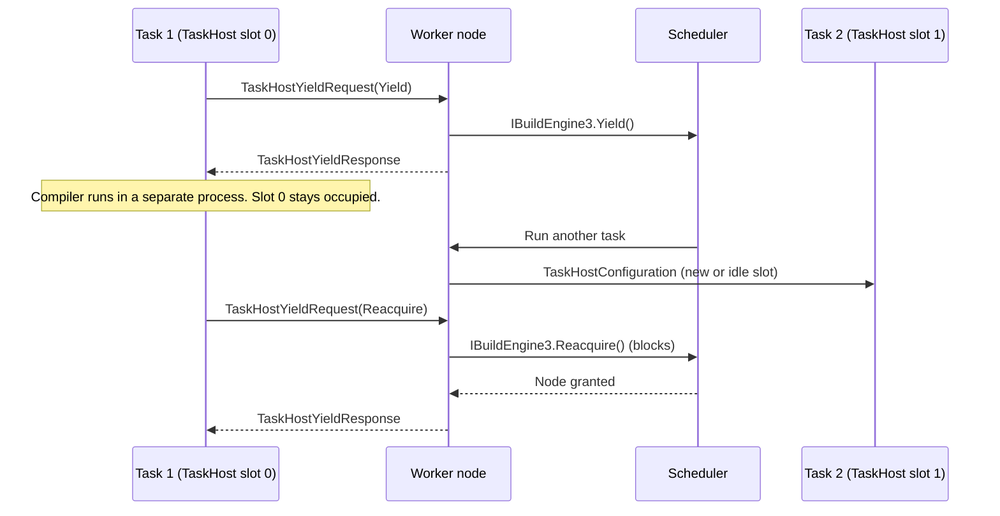
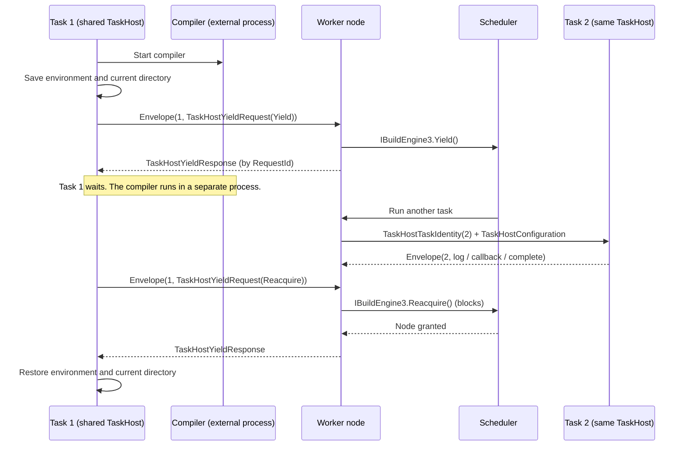

# Yield and Reacquire in TaskHosts

**Status:** Proposed. This document compares two prototype designs and recommends one.

Related documents:

- [Threading in TaskHost Processes](taskhost-threading.md) describes the current TaskHost thread model, callbacks, and lifecycle.
- [Multithreaded MSBuild](multithreaded-msbuild.md) describes `-mt` mode and sidecar TaskHosts.
- [Threading](../threading.md) describes `Yield` and `Reacquire` for in-process tasks.

## Problem

`IBuildEngine3.Yield()` lets a task give its node back to the scheduler while it does work that does not need the node, typically while a long external tool runs. `IBuildEngine3.Reacquire()` waits until the scheduler gives the node back. `ToolTask` does this when `YieldDuringToolExecution` is set. The C++ tasks `CL` and `MIDL` (CPPTasks) set it by default, so other projects can run on the node while the compiler runs.

MSBuild runs a task in an out-of-process TaskHost (`OutOfProcTaskHostNode`) when:

- the task needs a different runtime or architecture (for example, CLR4 tasks such as CPPTasks under `dotnet build`);
- multithreaded mode (`-mt`) moves a non-thread-safe task out of the worker node; or
- `MSBUILDFORCEALLTASKSOUTOFPROC` is set.

In a TaskHost, `Yield` and `Reacquire` are no-ops. The scheduler cannot use the node while the compiler runs. This can increase native C++ build times in `-mt` mode and under `dotnet build`.

### Measurements

A native C++ workload of 104 projects, built with `-m:8`. Values are medians.

| Configuration | Clean | No-op |
|---|---:|---:|
| `MSBuild.exe`, in-process tasks | 39.2 s | 3.3 s |
| `MSBuild.exe -mt` (`CL`/`MIDL` in a TaskHost, `Yield` is a no-op) | 99.4 s | 3.6 s |
| `dotnet build` (CLR4 TaskHost, no yield) | 117.7 s | 11.9 s |
| `dotnet build -mt` (no yield) | 113.0 s | 9.6 s |

The `YieldDuringToolExecution` comparison supports the importance of yielding for clean builds. With it disabled, in-process clean builds took 66.1–95.8 s, compared with 35.5–37.7 s when it was enabled.

## Requirements common to both options

Both prototypes forward `Yield` and `Reacquire` across the TaskHost boundary with these rules:

- **Negotiation.** The feature is available only when both peers negotiate packet version 9 (`NodePacketTypeExtensions.TaskHostYieldMinVersion`). Older peers and the CLR2 `MSBuildTaskHost` keep the no-op behavior.
- **Opt-out.** The feature is behind [change wave 18.14](../../wiki/ChangeWaves.md#1814). Opting out restores no-op `Yield` and `Reacquire` and the current routing. The parent tells the TaskHost its policy, so a reused TaskHost follows the current parent's wave.
- **Reacquire ordering.** The parent sends the response to `TaskHostYieldRequest(reacquire: true)` only after the real `IBuildEngine3.Reacquire()` returns. The task cannot continue before the scheduler gives its node back.
- **Scheduler accounting.** The parent calls the real `IBuildEngine3.Yield()` and `Reacquire()`. Node and core accounting, including the release of requested cores on `Reacquire` (see [resource management](../resource-management.md)), use the existing scheduler paths.
- **Contract enforcement.** As in the in-process engine, these calls throw: `Yield` twice, `Reacquire` without `Yield`, and `Reacquire` on a thread other than the one that called `Yield`.
- **Unbalanced exit.** If a task completes or throws while yielded, the parent must reacquire for the task before it processes the result. See [Reacquire before completion](#reacquire-before-completion).
- **No hangs.** Cancellation, or loss of the connection, while a task waits in `Reacquire` must unblock the task and release its registrations.

### Reacquire before completion

The engine requires a request to be reacquired after a real `Yield` and before the request reports its result. However, the engine does not check this when a task ends:

- A successful local completion requires the request entry to be `Active` (`BuildRequestEntry.Complete`). The scheduler requires the request to be `Executing` when it records any result, including a failure (`Scheduler.ReportResult`).
- When a task ends, `TaskBuilder` calls `TaskHost.MarkAsInactive`, which does not check the yield state.
- In a test with the .NET 11 RC1 SDK at `-m:1`, an in-process task that returned while yielded made the build hang after later tasks ran. A failing task in the same state caused internal error MSB0001, because the request was `Yielding` instead of `Executing`.

Out-of-process `Yield` is a no-op today, so a hosted task that never reacquires still succeeds. When `Yield` is forwarded, the TaskHost implementation must preserve that invariant itself:

- The parent tracks whether each task is yielded. Option B tracks this per task ID, because one host can contain several yielded tasks.
- The parent reacquires for the task on every exit path: completion, exception, host crash or disconnect, and cancellation. It does this before it applies outputs or environment changes from the task. In the prototypes, `TaskHostTask.ReacquireIfYielded` does this.
- This reacquire waits for the scheduler to give the node back. Cancellation during the wait must not hang. A failed reacquire, for example `BuildAbortedException`, is recorded and reported after host cleanup.

Two related decisions are separate from this design:

- **Report unbalanced tasks?** Both prototypes keep a task that returns while yielded successful, which matches today's TaskHost behavior. A new error or warning would break builds that succeed today, including `-warnaserror` builds. If a diagnostic is added, it should be a message or be opt-in. The parent must reacquire even when the task fails, because the scheduler also requires `Executing` for failed results.
- **Engine-level handling.** A clear engine check, or an automatic reacquire in `TaskBuilder`, would fix the in-process hang and could centralize some cleanup. It would not remove the TaskHost protocol, task-ID routing, or cancellation handling. The hook must run before task results are applied, which is earlier than `MarkAsInactive`. It must also call `Reacquire` on the thread that called `Yield`, and it must handle cancellation. This is a separate change that affects in-process tasks.

The main difference between the options is how they isolate the process state of tasks that run at the same time, and how they protect that isolation.

## Option A: process-level isolation

Prototype: [branch `baronfel-taskhost-yielding`](https://github.com/dotnet/msbuild/tree/baronfel-taskhost-yielding), current [commit `9f3b3ae8b9`](https://github.com/dotnet/msbuild/commit/9f3b3ae8b9dcda9c8f4fb990f06780241772ad20).

A TaskHost that contains a yielded, still-running task stays occupied. If other work needs a TaskHost of the same kind, the provider assigns another host slot (`TaskHostNodeKey.HostSlot`), which starts another process. Idle slots are reused.

### Protocol

- `TaskHostYieldRequest` and `TaskHostYieldResponse`.
- `TaskHostYieldConfiguration`, which carries the parent's change-wave policy before each task configuration.
- There are no other changes to routing. The provider keeps its existing handler stacks.

### Behavior

- Each running task has its own TaskHost process. The environment, current directory, `Console`, and static fields are isolated from other tasks. External resources, such as files, can still be shared.
- A yield-capable host runs the nested tasks of a `BuildProjectFile` callback in a separate process. Otherwise the outer task could resume in the same process while an inner task is still yielded. This removes the existing reuse of the process for nested tasks.

## Option B: shared TaskHosts with task-ID routing

Prototype: [branch `baronfel-taskhost-yielding-option-b`](https://github.com/dotnet/msbuild/tree/baronfel-taskhost-yielding-option-b), current [tip `b841c2dbe9`](https://github.com/dotnet/msbuild/commit/b841c2dbe9fb2f5ab7a4a4d610e74696bb4e23d2).
Tested implementation: [commit `09842896bd`](https://github.com/dotnet/msbuild/commit/09842896bd1e4255ef57b02b6bd6fc52565e1436).

There is one TaskHost per (worker node, runtime) key, as today. Each host runs at most one non-yielded task, plus any number of yielded tasks. Yielded tasks can continue to run in the same TaskHost process as the new task. An external compiler runs in its own process, not in the TaskHost.

### Protocol

- `TaskHostTaskIdentity` gives the next `TaskHostConfiguration` a task ID that is unique in the parent process.
- `TaskHostTaskEnvelope` wraps each task-scoped packet from the child (log events, callback requests, completion) with its task ID. The provider sends the inner packet to the handler for that ID (`_taskIdToHandler`). A packet without an envelope goes to the existing handler stack.
- Responses are not wrapped. The child matches each response to its request by `RequestId`.
- `TaskHostYieldRequest` and `TaskHostYieldResponse`.
- `TaskHostTaskCancel` cancels one task. The legacy `TaskHostTaskCancelled` still cancels all tasks in the host.

### Behavior

- `Yield` saves the task's environment and current directory. `Reacquire` restores them, as the in-process engine does for a yielded project.
- If a yielded task calls `BuildProjectFile`, the child reacquires the node, runs the nested build, and then yields again. This keeps the TaskHost behavior from before this feature. An in-process task that does this fails with MSB0001.
- The TaskHost process must register the exception serialization contract (`OutOfProcTaskHostNode.InitializeSerializationContract`). Without it, a `BuildAbortedException` in a yield response crashes the shared host, and all tasks in that host fail. The prototype includes this fix.

### Risks and limitations

- **Shared process state.** While yielded, a task must not read or change process-wide state: environment variables, the current directory, `Console`, or static fields. A tool started while the task is yielded must get its intended environment and working directory explicitly. The TaskHost cannot enforce this rule. A task that breaks it can affect other tasks in the same host. In-process yielded tasks have the same rule, but explicit TaskHost yields did not previously allow this overlap.
- `Console` redirection is shared by all tasks in the host.
- After a per-task cancel, the host exits only after all of its task contexts finish.
- Log messages that arrive after an abort can be lost.
- If the build is cancelled while a task waits in `Reacquire`, the task gets a `GenericBuildTransferredException`. An in-process task gets `BuildAbortedException`. `ToString()` keeps the original type name.
- The protocol change is larger, and routing changes for all task-scoped packets when the feature is enabled.

### Relation to the existing `BuildProjectFile` callback

The existing nested `BuildProjectFile` callback already supplies much of the foundation for Option B:

- The callback uses the same scheduler path as an in-process task that builds a project reference. The calling task's node is given back while the nested build runs.
- While the calling thread waits, another task can run in the same TaskHost. The TaskHost keeps one `TaskExecutionContext` per task, and saves and restores the environment and current directory around the callback (`BlockForCallback`, `ResumeAfterCallback`).
- When a scheduled nested build completes normally, the callback waits for the scheduler to reacquire the node before the parent sends `TaskHostBuildResponse`.
- If the request is still active and not cancelled, `TaskHostTask` attempts to reactivate its handler before sending the response. `TryReactivateTaskHandler` moves that handler to the top of the provider's handler stack, even if another task is still blocked. Resumption is therefore not strictly last-in, first-out.

The callback model does not cover explicit `Yield`:

- `IBuildEngine3.Yield()` and `Reacquire()` are no-ops in the TaskHost. A callback blocks the calling thread, although other threads created by the task can still run.
- A truly yielded task continues to run while another task is active in the same process. The yielded task can log or complete during that time.
- The provider routes task-scoped packets such as logs and completion to the handler at the top of the stack. A packet from a yielded task can therefore go to the active task's handler.

Option B adds these parts to the callback foundation:

- Task-ID envelopes and `_taskIdToHandler` routing, so that each packet reaches the handler of the task that sent it.
- Per-task cancellation with `TaskHostTaskCancel`.
- Forwarding of `Yield` and `Reacquire` to the existing scheduler path in `TaskHostTask`.
- Tracking of yielded task contexts through `Reacquire`, completion, and failure, with a parent-side reacquire if the task ends while yielded.

Option B does not isolate process-wide state while tasks overlap. Unlike a callback, an explicit yield does not block the calling thread. The risk in [Risks and limitations](#risks-and-limitations) applies.

## Comparison

### Performance

Measured with `dotnet build -m:8` on the same workload. Times are elapsed wall-clock times. CPU utilization was not measured. Process counts and peak process-tree RSS are for clean builds.

Both published prototype branches are rebased on the CLR4 TaskHost support [commit `102f08a36b`](https://github.com/dotnet/msbuild/commit/102f08a36b153123ffa697a250a68b6f7e26b572).
The measurements used Option A [commit `1499e7d2e3`](https://github.com/dotnet/msbuild/commit/1499e7d2e3415428ee70239a87d0fbbc3e0436f1) and Option B [commit `1bd382fdcc`](https://github.com/dotnet/msbuild/commit/1bd382fdcc707651a8b091e4cf52415c595bcd4f).
The rebased implementation commits (`9f3b3ae8b9` and `09842896bd`, respectively) have identical Git trees to their measured counterparts.
Option B's current tip adds only documentation after its tested implementation commit.

Normal mode, 4 rounds of each option. Runs were sequential, with variant order varied across rounds:

| Configuration | Clean | No-op | TaskHost processes | Peak process-tree RSS |
|---|---:|---:|---:|---:|
| Option A | 41.80 s | 10.15 s | 26–30 | 3.31 GB |
| Option B | 40.17 s | 9.94 s | 8 | 2.37 GB |
| Yield disabled | ~103–104 s | — | 8 | 2.06 GB |

`-mt` mode, 2 rounds of each option. Runs were sequential: A then B in the first round, B then A in the second:

| Configuration | Clean | No-op | TaskHost processes | Peak process-tree RSS |
|---|---:|---:|---:|---:|
| Option A | 40.76 / 40.84 s | 14.93 / 13.61 s | 26 | 2304 MiB |
| Option B | 35.56 / 35.95 s | 8.12 / 7.95 s | 8 | 1345 MiB |

Notes:

- Both options remove most of the clean-build regression. The `-mt` clean build goes from about 113 s to 36–41 s, which is close to in-process `MSBuild.exe` (39.2 s).
- The baselines in [Measurements](#measurements) were captured on a different day, and the sample counts are small.
- The `-mt` prototype no-op builds took about 8–15 s, compared with 3.3 s for the earlier in-process `MSBuild.exe` baseline. These measurements do not establish the cause or whether yield affects no-op performance.

### Summary

| Axis | Option A: process isolation | Option B: shared hosts, task-ID routing |
|---|---|---|
| **Safety** | Stronger process-state isolation. Each running task has its own TaskHost process, although external resources can still be shared. | Weaker. Yielded tasks share process state, and the rule cannot be enforced. A task that breaks the rule or a host crash can affect other tasks in the host. |
| **Implementation** | Small protocol change (yield request, response, and policy). Adds host-slot management, and nested callbacks no longer reuse the process. | Larger protocol change: identity, envelopes, per-task cancel, and routing by task ID. Needs environment save and restore, and more complex cancel and drain logic. |
| **CPU / build time** | The clean build took 41.80 s in normal mode and about 40.8 s in `-mt`. The `-mt` no-op runs took 13.61–14.93 s. | The clean build took 40.17 s in normal mode and 35.56–35.95 s in `-mt`. The `-mt` no-op runs took 7.95–8.12 s. |
| **Memory** | Highest. 26–30 TaskHosts, 3.31 GB in normal mode and 2304 MiB in `-mt`. Grows with the number of overlapping yielded tasks. | 8 TaskHosts, as without yield. 2.37 GB in normal mode and 1345 MiB in `-mt`. |

## Recommendation

Use **Option B** if its shared-state risk is acceptable, and require these mitigations:

1. **Shared-state guard tests.** Run representative yielding tasks alongside controlled probe tasks in one TaskHost, including the CPPTasks `CL` and `MIDL` paths where feasible. Sample selected environment, current-directory, and `Console` state at synchronized checkpoints. Check restoration and observable interference against the test expectations. Include an intentional mutation at a checkpoint to verify that the probe detects that case. These tests cover selected values and interleavings, not all tasks, static fields, or transient changes between checkpoints.
2. **Restoration diagnostics.** After `Reacquire`, compare selected restored environment and current-directory values with the saved snapshot. Report mismatches through a low-importance message or an `EventSource` event. A mismatch shows that sampled state differs, but does not identify the source. A match does not rule out transient changes or interference that occurred before restoration. The comparison does not cover `Console` or static fields.
3. **Opt-out.** Keep the change wave 18.14 opt-out so builds can return to the previous behavior if shared-state interference is suspected.
4. **Robust host.** Keep the serialization-contract fix and tests that kill or cancel a host while a task waits in `Reacquire`. These tests cover the corresponding paths that could strand sibling tasks.

Neither the tests nor the diagnostics enforce isolation. They cannot guarantee safety for arbitrary tasks. If that residual risk is unacceptable, choose Option A.

In these measurements, Option B had lower clean-build elapsed times and peak RSS in both modes. The samples are small. Option A needs more TaskHost processes when yielded tasks overlap. Option B's main risk is shared process state. In-process yielded tasks must follow the same rule. `ToolTask` starts its external tool in a separate process before calling `Yield`. While yielded, it waits, logs output, and handles cancellation or timeout.

If tests or field observations expose unacceptable interference, use Option A or assess a per-task isolation setting.

## Validation

Both prototypes test:

- overlapping yielded tasks at low node counts (`-m:2`), in normal and `-mt` modes;
- overlapping CLR4 TaskHosts started from .NET MSBuild;
- invalid or unbalanced sequences at `-m:1`, for example `Yield` twice or `Reacquire` without `Yield`, which must not strand the scheduler;
- `Reacquire` that waits for the parent's response and is unblocked by cancellation or disconnection;
- nested `BuildProjectFile` callbacks, including inherited launch settings for .NET TaskHosts; and
- capability and change-wave gating (packet version 8 against 9, and the 18.14 opt-out), plus host reuse.

Option A also tests that hosts occupied by yielded tasks use separate slots and that idle hosts are reused.

Option B also has end-to-end tests for:

- cancelling the build, or killing the host, while a task waits in `Reacquire`;
- nested `BuildProjectFile` callbacks from yielded tasks with several levels, in `-mt` mode, and from CLR4 TaskHosts; and
- overlapping yielded tasks that share one TaskHost process.

Option B must also add the shared-state guard test from the [recommendation](#recommendation).

## Open questions

- Should Option B allow a task to request a separate TaskHost when it cannot follow the shared-state rule?
- What causes the observed no-op time differences, and does enabling yield affect them?
- Should the engine check, or automatically fix, a task that returns while yielded? This applies to in-process tasks and TaskHosts. See [Reacquire before completion](#reacquire-before-completion).
